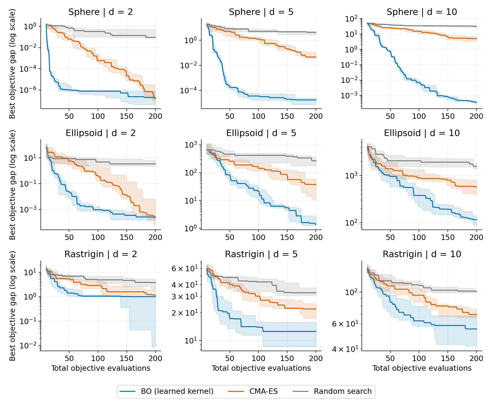
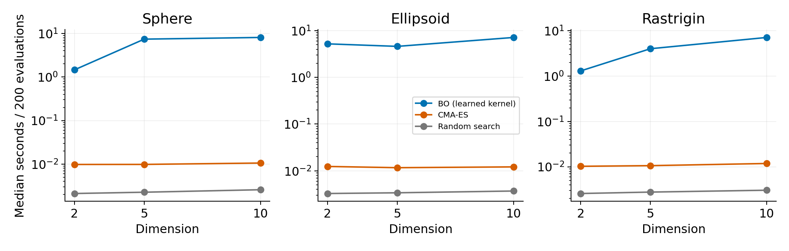
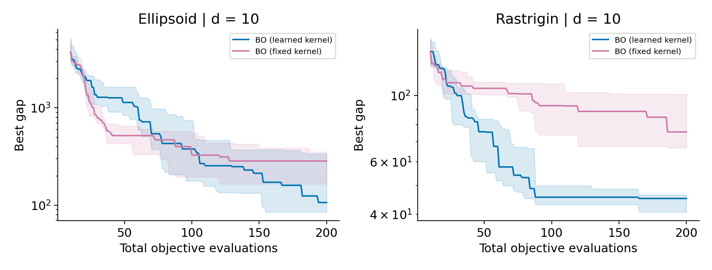
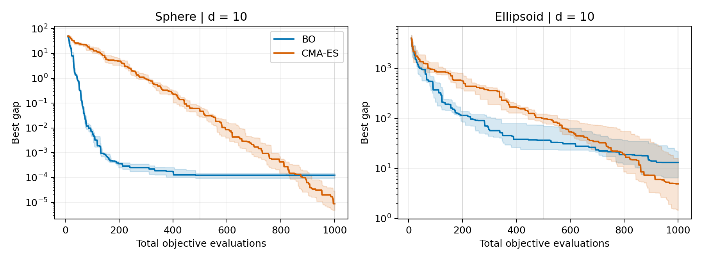

# Bayesian Optimization versus CMA-ES under Limited Evaluation Budgets

**Performance across input dimensions and evaluation budgets on synthetic objectives**

Esther Lee | Student number: A0255546X | DSA4212

**GitHub repository:** https://github.com/sderle2/bo-vs-cma-es.git

## Abstract

We compare Gaussian-process Bayesian optimization (BO), CMA-ES and uniform random search on shifted Sphere, rotated Ellipsoid and shifted Rastrigin. The main experiment uses dimensions 2, 5 and 10, ten matched trials and 200 evaluations. BO with a GP length-scale upper bound of 2 has the smaller d=10 median gap on all three families at 200 evaluations. An exploratory extension on the same d=10 Sphere and Ellipsoid instances finds that at 1,000 evaluations CMA-ES beats bound-2 BO in ten and six trials, respectively. With bound 4, BO has a smaller Ellipsoid median gap than CMA-ES at 1,000 evaluations, while CMA-ES still leads on Sphere. The rankings depend on the evaluation budget and GP setting for these reused instances. BO also has higher wall-clock overhead on these cheap objectives.

## 1. Question, hypotheses and evidence status

Black-box optimization observes objective values without analytic derivatives. BO uses a probabilistic surrogate and acquisition rule [1], while CMA-ES adapts a candidate distribution from rankings [2]. We ask: **How do BO and CMA-ES compare across input dimensions and evaluation budgets, and is CMA-ES's disadvantage at 200 evaluations partly a short-budget effect?**

The initial prediction was that BO could benefit under small budgets while its overhead could outweigh evaluation savings. After seeing BO lead at d=10 and 200 evaluations, we added the budget extension. Competing predictions were recorded before new runs: CMA-ES would either close its relative gap with more evaluations, or BO's advantage would persist. The extension is exploratory and reuses inspected instances; it tests budget sensitivity, not independent confirmation or a proven covariance-adaptation mechanism.

<!-- PAGEBREAK -->

## 2. Methods

**BO.** A GP with zero mean after output standardization and an isotropic Matern 5/2 covariance is conditioned on all observations. Signal variance starts at 1 with bounds [.01,100]; length-scale starts at .25 with bounds [.02,2]. A 1e-8 diagonal regularizer is used in normalized-output units. Kernel parameters are refitted by marginal likelihood every five proposals without restarts; posterior conditioning is updated every proposal. For minimization, EI is E[max(b - f(x), 0)]. Acquisition search uses 128 uniform candidates and three bounded L-BFGS-B starts of at most 35 iterations, minimizing -log(EI + 1e-30). It rejects points within 1e-7 of an observation and does not certify a global EI maximum [1,5,7].

**CMA-ES and random search.** Pycma 4.5.0 uses bounds [0,1]^d, step size .25 and default population size [2,6]. All methods charge the same ten initial evaluations to their budgets and count them toward best-so-far. BO conditions on all ten observations. CMA-ES uses their best point as its initial mean, which may affect early comparisons. Stop flags are logged without restarts. A final partial population is evaluated without an update. Random search retains the initial design and samples uniformly.

Ten shared initial evaluations give BO data for its first GP fit and CMA-ES a starting point while reserving most of the budget for search. Refitting hyperparameters every five proposals is a computational compromise that limits repeated marginal-likelihood optimization while updating the posterior at each proposal.

The GP covariance concerns function values; the CMA covariance concerns candidate inputs. They are different objects. All methods run sequentially with numerical-library threads limited to one.

## 3. Objectives and experimental design

For center c in [.25,.75]^d, let z = 10(x - c). Sphere is sum_i z_i^2, Ellipsoid is sum_i 1000^(i/(d-1)) (Qz)_i^2 for seeded orthogonal Q, and Rastrigin is sum_i [z_i^2 + 10(1 - cos(2*pi*z_i))]. All sums use i = 0, ..., d-1. The minimum is zero at c. These are custom instances inspired by COCO/BBOB benchmarks [3].

The main design crosses three functions, d=2,5,10, trials 0-9 and BO/CMA/random, for 270 runs and 54,000 evaluations. Methods share each trial's objective and ten initial inputs, but post-initial randomness is method-specific. The primary metric is g_t = min_{i<=t} f(x_i) - f* = min_{i<=t} f(x_i), summarized by median and IQR. IQR is not a confidence interval.

The extension uses unchanged BO and CMA-ES settings on d=10 Sphere and Ellipsoid, trials 0-9, to a common cap of 1,000. These are fresh reruns from the original seeds, not restored continuations. Their first 200 trajectories had to match the main runs before interpretation. Checkpoints 200/500/1,000 are repeated observations, not independent samples. A tie requires |g_CMA - g_BO| <= 1e-8 max(1, |g_CMA|, |g_BO|). Raw gaps are never pooled across functions.

The cap was selected from a separate trial-91 Sphere timing pilot. It projected the design below 30 minutes, but function-dependent BO cost caused pilot plus extension metadata to total 32.22 minutes. This 2.22-minute overrun is a design limitation; piloting both functions would have been better.

<!-- PAGEBREAK -->

## 4. Main experiment: evaluation efficiency

**Figure 1.** Median best gap versus total evaluations; shading is IQR across ten matched trials. Each panel has its own log range. Display values are clipped only below 1e-10.

<!-- PAGEBREAK -->

### 4.1 Main numerical results

| Function | d | BO @50 | CMA @50 | BO @200 | CMA @200 | RS @200 |
|---|---|---|---|---|---|---|
| Sphere | 2 | 1e-06 | 0.0632 | 1.97e-07 | 1.53e-07 | 0.0913 |
| Sphere | 5 | 0.000178 | 5.01 | 1.72e-05 | 0.0462 | 4.3 |
| Sphere | 10 | 0.772 | 26.2 | 0.000361 | 4.94 | 31.7 |
| Ellipsoid | 2 | 0.0236 | 5.69 | 0.000259 | 0.000237 | 3.4 |
| Ellipsoid | 5 | 83.3 | 255 | 1.4 | 37.6 | 266 |
| Ellipsoid | 10 | 956 | 1.38e+03 | 116 | 576 | 1.55e+03 |
| Rastrigin | 2 | 1.4 | 5.33 | 1 | 1.13 | 3.78 |
| Rastrigin | 5 | 17.3 | 40.3 | 12.5 | 21.9 | 32.8 |
| Rastrigin | 10 | 84.8 | 110 | 55.2 | 69.7 | 101 |

**Table 1.** Median gaps; smaller is better. RS is random search. Rows are not pooled across incompatible scales.

At 50 evaluations BO has the smaller median than CMA-ES in all nine settings. At 200, CMA-ES is marginally smaller only on d=2 Sphere and Ellipsoid; BO remains smaller in the other seven settings, including all d=10 families. The d=2 Ellipsoid trajectory shows how late the reversal can be: BO/CMA medians are 0.0236/5.69 at 50 and 0.000949/0.417 at 100, while CMA becomes sustainably no worse only at evaluation 197 and finishes 0.000237 versus 0.000259. This endpoint difference is tiny and descriptive, not evidence of significance.

Dimension is not isolated: the objective instances, search volume and evaluations per variable change. The main result therefore says that higher tested dimension did not automatically select CMA-ES under a fixed 200-evaluation cap; it does not establish a causal dimension effect.

## 5. Computational cost

**Figure 2.** Median seconds per 200-evaluation run on the same host, plotted on a log scale.

| Method | Median seconds | Min | Max |
|---|---|---|---|
| bo | 4.8765 | 0.9387 | 9.2289 |
| cma | 0.0109 | 0.0089 | 0.0254 |
| random | 0.0028 | 0.0020 | 0.0104 |

**Table 2.** Elapsed seconds per 200-evaluation run across the 90 main runs for each method.

BO's median is about 4.88 seconds across its 90 main runs, versus 0.0109 for CMA-ES. Objective arithmetic is extremely cheap, so GP conditioning and acquisition search dominate. These timings do not identify the faster method for expensive or parallel evaluations.

<!-- PAGEBREAK -->

## 6. Exploratory kernel sensitivity

The learned-versus-fixed-kernel follow-up was selected after inspecting part of the main results. It uses fresh d=10 Ellipsoid and Rastrigin trials 100-109 and is exploratory.

**Figure 3.** Median best gap with IQR for learned- and fixed-kernel BO over ten matched trials.

| Function (d=10) | Kernel | Median gap | Median seconds |
|---|---|---|---|
| ellipsoid | bo | 106.6 | 7.038 |
| ellipsoid | bo_fixed | 284.5 | 8.282 |
| rastrigin | bo | 45.22 | 7.094 |
| rastrigin | bo_fixed | 75.56 | 7.696 |

Learned BO has the smaller final gap in 9/10 Ellipsoid and 9/10 Rastrigin trials. The fixed variant is not an optimal fixed-kernel oracle.

The saved timing components explain the initially surprising slower fixed-kernel totals. On Ellipsoid, learned/fixed median fitting times are 0.224/0.127 seconds, but acquisition times are 6.815/8.160; on Rastrigin they are 0.268/0.135 for fitting and 6.829/7.552 for acquisition. Fixed kernels save hyperparameter fitting time, yet their acquisition searches take longer. Different trajectories or local-optimizer work are plausible explanations, but optimizer iteration counts were not logged, so the cause is unresolved.

<!-- PAGEBREAK -->

## 7. Exploratory budget extension

**Figure 4.** Median best gap with IQR on the reused d=10 main instances. Vertical guides mark 200, 500 and 1,000 evaluations.

| Function | Eval. | BO median [IQR] | CMA median [IQR] | Wins BO/CMA/tie |
|---|---|---|---|---|
| Sphere | 200 | 0.000361 [0.00025, 0.000407] | 4.94 [3.4, 6.51] | 10/0/0 |
| Sphere | 500 | 0.000125 [9.36e-05, 0.000148] | 0.0469 [0.0282, 0.0688] | 10/0/0 |
| Sphere | 1000 | 0.000125 [9.36e-05, 0.000148] | 8.88e-06 [4.83e-06, 2.92e-05] | 0/10/0 |
| Ellipsoid | 200 | 116 [85.8, 140] | 576 [397, 814] | 10/0/0 |
| Ellipsoid | 500 | 36.8 [24, 74.6] | 101 [81.8, 124] | 9/1/0 |
| Ellipsoid | 1000 | 13.2 [6.53, 22] | 4.93 [1.46, 16.2] | 4/6/0 |

**Table 3.** Medians [IQR] and matched-trial wins using the predeclared tie tolerance. Checkpoints share trajectories and are not independent samples.

**Supporting evidence for a short-budget effect.** For each matched trial, the log gap ratio is log10((CMA gap + 10^(-12))/(BO gap + 10^(-12))). From 200 to 1,000 evaluations, the checkpoint median moves from 4.10 to -1.15 on Sphere and from 0.73 to -0.55 on Ellipsoid. The differences between checkpoint medians are -5.26 and -1.28, respectively. The CMA-ES median gap first becomes no larger than BO's at evaluations 875 and 803, respectively, and remains so through 1,000.

**Contradictory and qualifying evidence.** BO still wins every Sphere trial and nine of ten Ellipsoid trials at 500. On Ellipsoid, BO remains better in four trials at 1,000, and its relative advantage increases from 200 in two trials even though the median reverses. The result is therefore a late, function-dependent crossover—not evidence that CMA-ES always dominates with enough evaluations.

**Illustrative failure case.** Before inspecting individual traces, failure was defined as the largest final worse/better gap ratio across the 20 matched function-trial pairs. This selects Ellipsoid trial 9, where BO is the worse method by a ratio of 138.0. BO/CMA gaps change from 66.1/535 at 200 to 21.7/0.158 at 1,000. The trace illustrates a late CMA improvement and BO plateau, but one selected case is not representative and does not reveal the mechanism.

<!-- PAGEBREAK -->

## 8. GP length-scale bound sensitivity

All 20/20 BO runs in the budget extension recorded a final length-scale at the upper bound of 2. We used 4 as a simple exploratory doubling to allow longer fitted scales. The same ten 10D instances per function, seeds, initial observations and other BO settings were retained. We reuse the saved bound-2 BO and CMA-ES trajectories at identical evaluation checkpoints.

| Function | Evals | BO bound 2 | BO bound 4 | CMA-ES | BO 4 < BO 2 | BO 4 < CMA |
|---|---|---|---|---|---|---|
| Sphere | 200 | 0.000361 | 0.00113 | 4.94 | 1/10 | 10/10 |
| Sphere | 500 | 0.000125 | 0.00113 | 0.0469 | 1/10 | 10/10 |
| Sphere | 1,000 | 0.000125 | 0.00113 | 8.88e-06 | 1/10 | 0/10 |
| Ellipsoid | 200 | 116 | 99.7 | 576 | 5/10 | 10/10 |
| Ellipsoid | 500 | 36.8 | 15.3 | 101 | 9/10 | 9/10 |
| Ellipsoid | 1,000 | 13.2 | 2.74 | 4.93 | 8/10 | 6/10 |

**Table 4.** Median best-so-far gaps and strict matched-trial win counts for bound 4. Smaller gaps are better. Counts exclude ties, and checkpoints share the same trajectories.

**Ellipsoid.** Bound 4 gives a smaller median gap at all three checkpoints. At 1,000 evaluations it lowers the median from 13.2 to 2.74 and beats bound 2 in 8/10 trials. Its median is also below CMA-ES's 4.93, with 6/10 matched wins. Thus the 1,000-evaluation ranking on Ellipsoid changes under the wider bound.

**Sphere.** Bound 4 gives a larger median gap at all three checkpoints and beats bound 2 in only 1/10 trials at each checkpoint. At 1,000 evaluations the medians are 0.00113 for bound 4, 0.000125 for bound 2, and 8.88e-06 for CMA-ES. CMA-ES beats both BO variants in all ten trials at that checkpoint.

**Paired differences at 1,000 evaluations.** Subtract the comparator's final gap from bound-4 BO's gap within each trial, so negative values favor bound 4. On Ellipsoid, the median paired difference [Q1, Q3] is -7.92 [-18.7, -4.36] against bound 2 and -2.53 [-14.6, 2.73] against CMA-ES. The middle half of the CMA-ES comparisons spans gains and losses. On Sphere, the corresponding summaries are 0.000964 [0.00085, 0.00128] and 0.00109 [0.000944, 0.00132]. Both middle halves favor the comparator. These intervals describe variation across trials.

For the Matérn kernel, a longer length-scale makes prior correlation decay more slowly with distance. This can change the GP posterior mean and uncertainty, and thus the Expected Improvement scores that guide BO. The isotropic kernel uses the same correlation scale in every direction, so it cannot express distinct directional correlation scales that could reflect rotated Ellipsoid's unequal curvature. A wider bound could therefore alter the search differently across objectives. All 20 bound-4 runs reached 4 at the final recorded refit. This boundary behavior motivates sensitivity checks, but does not identify which posterior or acquisition changes produced the observed differences. Performance beyond bound 4 and on new instances remains open.

<!-- PAGEBREAK -->

## 9. Revised interpretation, limitations and conclusion

**Observed evidence.** In the original comparison with bound-2 BO, CMA-ES has a larger median gap at 200 evaluations and a smaller median gap at 1,000 on the reused d=10 Sphere and Ellipsoid instances. The advantage at 200 therefore depends partly on the budget under that setting. At 1,000 evaluations, bound 4 reverses the Ellipsoid ranking observed with bound 2: BO has the smaller median gap and wins 6/10 matched trials. On Sphere, CMA-ES still wins 10/10. The bound-4 comparison is summarized at three checkpoints.

**Plausible explanations.** BO can exploit a small sample quickly, while CMA-ES may require more ranked generations to refine its sampling distribution. The budget extension does not isolate covariance adaptation. The bound comparison shows that BO's late performance and its ranking against CMA-ES depend on the objective and GP settings in this study.

**Unresolved questions and limitations.** The extension was selected after seeing the main results, reuses the same instances, and exceeded its runtime target. Ten trials combine instance and algorithm randomness. BO uses all initial values while CMA starts only from their best point. There is no ARD, CMA restart/population study, independent replication, noisy or expensive objective, or optimizer-iteration log. The 3,899 extension GP warnings and 6333 combined main/follow-up/extension warnings are counts, not distinct failed fits; warning messages were not retained and no warning-producing run was excluded. Host timing is uncontrolled. Medians/IQRs and win counts are descriptive, not tests of statistical significance.

**Conclusion.** At 200 evaluations bound-2 BO has the smaller median gap on all three tested d=10 families. By 1,000, CMA-ES beats bound-2 BO on both extended families by median gap. With bound 4, CMA-ES still leads on Sphere and BO leads on Ellipsoid. Algorithm rankings in these experiments depend on the evaluation horizon and GP settings. BO has much higher overhead on these cheap objectives.

## Reproducibility

The extension contains 40 runs and 40,000 evaluations. Its 8,000 first-200 rows match the main trajectories exactly; all extension values were recomputed from saved inputs with maximum discrepancy 1.46e-11. Together, the main, kernel follow-up and extension contain 102,000 stored evaluations; the separate runtime pilot is excluded from outcome analysis. Configurations, hashes, full histories, summaries and figure scripts are included.

## References

[1] Frazier, P. I. (2018). A Tutorial on Bayesian Optimization. arXiv:1807.02811v1. https://arxiv.org/abs/1807.02811

[2] Hansen, N. (2023 version). The CMA Evolution Strategy: A Tutorial. arXiv:1604.00772v2. https://arxiv.org/abs/1604.00772

[3] Hansen et al. (2020). COCO: A Platform for Comparing Continuous Optimizers in a Black-Box Setting. arXiv:1603.08785v4. https://arxiv.org/abs/1603.08785

[4] Eriksson et al. (2019; 2020 version). Scalable Global Optimization via Local Bayesian Optimization. NeurIPS. arXiv:1910.01739v4. https://arxiv.org/abs/1910.01739

[5] Scikit-learn: GaussianProcessRegressor documentation. https://scikit-learn.org/stable/modules/generated/sklearn.gaussian_process.GaussianProcessRegressor.html

[6] Pycma: CMAEvolutionStrategy documentation. https://cma-es.github.io/apidocs-pycma/cma.evolution_strategy.CMAEvolutionStrategy.html

[7] Thiery, A. DSA4212 course notebooks: Gaussian processes with scikit-learn; Bayesian optimization in one dimension. Provided course solutions, Tasks G1-G7 and B1-B8.
